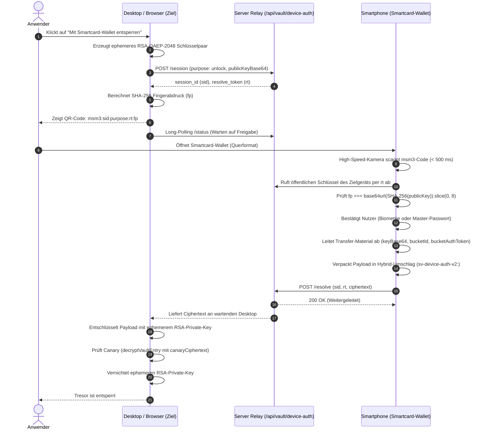

# Maunting Smartcard-Architektur & Wallet-Protokoll

## 1. Leitgedanke & Ursprung

Die Smartcard in Maunting Service Manager (MSM) entstand aus einer einfachen UX-Beobachtung: Ein kryptografisches Master-Passwort ist für Anwender ein unsichtbares, abstraktes Konstrukt.

Technisch tippt der Anwender eine Passphrase ein, die lokal von einem speicherharten Schlüsselableitungsalgorithmus (Argon2id mit 64 MiB Speicherbedarf) verarbeitet wird, um symmetrische Schlüssel (`userKey`) und blinde Identifikatoren (`bucketSeed`) zu berechnen. Für Anwender bleibt dieser Vorgang jedoch eine undurchsichtige Blackbox.

Die Smartcard (intern als *Maunting Card* implementiert) übersetzt dieses abstrakte kryptografische Geheimnis in eine intuitive physische Metapher:
* **Visuelle Identität:** Angelehnt an eine Bankkarte oder einen Krypto-Sicherheitstoken besitzt die Karte zwei Seiten im dreidimensionalen Raum, einen sichtbaren Chip, Nutzer-Avatar, Namen, Gültigkeitszeitraum (*Valid Thru*) sowie eine geprägte Identifikationsnummer (`MSM-XXXX-XXXX-XXXX`).
* **Haptik & Ästhetik:** Das Design verbindet klare Linien mit dezentem haptischem Feedback auf Mobilgeräten bei Freigabe- und Entsperraktionen.
* **Sicherheitsstatus auf einen Blick:** Ob der Tresor versiegelt ist, das aktuelle Gerät noch nicht autorisiert wurde oder eine Schlüsselrotation ansteht, lässt sich direkt an der Karte ablesen.

---

## 2. Warum die Smartcard existiert: Bedrohungsmodell & Nutzen

### A. Verständliches mentales Modell für Zero-Knowledge
In einer strikten Zero-Knowledge-Architektur speichert der Serverbetreiber zu keinem Zeitpunkt Schlüssel oder Klartextdaten. Geht das Master-Passwort verloren, sind die Daten unwiederbringlich weg. Herkömmliche Eingabefelder vermitteln diese Tragweite oft nur unzureichend.

Die Smartcard schafft ein klares mentales Modell: *Du besitzt diese kryptografische Karte, und du bestimmst, welches Gerät Zugriff darauf erhält.*

### B. Schutz vor Schulterblicken und Keyloggern
Um Offline-Wörterbuchangriffe auf erbeutete Ciphertexte abzuwehren, muss das Master-Passwort mindestens 12 Zeichen umfassen (`MASTER_PASSWORT_MINDESTLAENGE`). Ein solches Passwort wiederholt auf fremden Desktop-Rechnern, Besprechungsraum-PCs oder in geteilten Browser-Sitzungen einzutippen, birgt erhebliche Risiken:
1. Physisches Beobachten (Shoulder-Surfing) in offenen Büros oder an öffentlichen Orten.
2. Hardware- und Software-Keylogger auf unüberwachten Arbeitsplätzen.
3. Eingabeermüdung, die in der Praxis zu schwachen oder wiederverwendeten Passwörtern verleitet.

### C. Das Smartphone als Smartcard-Wallet
Statt das Master-Passwort auf dem Zielrechner einzugeben, dient das persönliche Mobiltelefon als Hardware-Token (Smartcard-Wallet):
1. Der Zielrechner zeigt einen kurzlebigen QR-Code.
2. Das Smartphone öffnet die Smartcard im Vollbild-Querformat und liest den Code über die Hintergrundkamera in unter 500 ms ein.
3. Der Nutzer bestätigt die Freigabe auf dem eigenen Smartphone per Biometrie (Fingerabdruck oder Face Unlock) oder Passwort.
4. Der Tresorschlüssel wird Ende-zu-Ende verschlüsselt direkt an das Zielgerät übertragen. Der Server fungiert als blinder Relay und erfährt weder Schlüssel noch Passwörter.

---

## 3. Unterschied: Master-Passwort vs. Smartcard

| Merkmal | Master-Passwort | Smartcard (Maunting Card) |
| :--- | :--- | :--- |
| **Natur** | Rohe geheime Passphrase (mindestens 12 Zeichen, existiert nur im Kopf des Nutzers). | Vollständiges Protokoll- und Interaktionsmodell (visuelle Identität und Krypto-Zustandsautomat). |
| **Speicherung** | Niemals persistent gespeichert. Wird nach der KDF-Ableitung sofort aus dem Speicher gelöscht. | Öffentliche und clientseitige Metadaten (Status, Gültigkeit, deterministische ID); keine Klartext-Schlüssel. |
| **Kryptografische Rolle** | Entropiequelle für die Argon2id-Schlüsselableitung. | Repräsentiert den Status (`uninitialized`, `unauthorized`, `locked`, `active`, `rotation_due`) und steuert die Gerätefreigabe. |
| **Identifikationsnummer** | Keine. | `MSM-XXXX-XXXX-XXXX`, deterministisch aus `bucketSeed` abgeleitet (kein Rückschluss auf das Passwort). |
| **Geräteübergreifender Einsatz** | Manuelle Tastatureingabe auf jedem einzelnen Rechner erforderlich. | Mobiler Authentikator für kamerabasierte E2EE-Sitzungsfreigabe. |
| **Lebenszyklus** | Statisch, bis der Nutzer es aktiv ändert. | Zeitlich begrenzt (`validThru`, 24 Monate Rotationszyklus) zur Durchsetzung regelmäßiger Schlüsselwechsel. |

---

## 4. Kryptografische Ableitungslogik

Die Smartcard nutzt die kryptografischen Bausteine von DIS (`@msdis/shield`), um alle benötigten Werte deterministisch und speicherhygienisch zu erzeugen.

```
                  ┌──────────────────────────────┐
                  │ Master-Passwort (≥ 12 Zeichen)│
                  └──────────────┬───────────────┘
                                 │
                                 ▼
                     Argon2id (64 MiB, t=3, p=4)
                        Salt: 16+ Bytes (Zufall)
                                 │
                                 ▼
                        64 Bytes Rohmaterial
                        im SecureBuffer
                        ┌────────┴────────┐
                        │                 │
                Bytes 0..31      Bytes 32..63
                        │                 │
                        ▼                 ▼
                    userKey          bucketSeed
                 (AES-256-GCM)            │
                                  ┌───────┴───────────────┐
                                  │                       │
                                  ▼                       ▼
                             SHA-256(seed)     SHA-256(seed || ':msm-vault-auth-v1')
                                  │                       │
                                  ▼                       ▼
                               bucketId             bucketAuthToken
                              (64 Zeichen)         (Server-Beweis)
                                  │
                                  ▼
                           formatCardNumber
                                  │
                                  ▼
                          MSM-XXXX-XXXX-XXXX
```

### Schritt 1: Speicherharte KDF (`deriveVaultTransferMaterial`)
```ts
import { argon2idRaw } from '@msdis/shield/kdf';

const rawBytes = await argon2idRaw({
  password: masterPassword,
  salt: saltBytes,
  memorySize: 65536, // 64 MiB RAM
  iterations: 3,
  parallelism: 4,
  hashLength: 64,
});
```

### Schritt 2: Aufteilung im `SecureBuffer`
Das 64-Byte-Ergebnis wird umgehend in einen `SecureBuffer` gekapselt; das flüchtige `rawBytes`-Array wird mit Nullen überschrieben:
* **Bytes 0..31 (`userKey`):** Symmetrischer AES-256-GCM Inhaltsschlüssel.
* **Bytes 32..63 (`bucketSeed`):** Zufalls-Seed zur Ableitung blinder Identifikatoren.

### Schritt 3: Deterministische Blind-IDs & Kartennummer
Aus dem `bucketSeed` werden zwei Werte gebildet:
1. `bucketId = SHA-256(bucketSeed)`: 64-stellige Hex-Zeichenkette als blinde Tresoradresse auf dem Server.
2. `bucketAuthToken = SHA-256(bucketSeed || ':msm-vault-auth-v1')`: Beweis gegenüber dem Server, dass der Client berechtigt ist, den Tresor-Container zu lesen oder zu schreiben.
3. **Formatierte Kartennummer:** Die ersten 12 Hex-Zeichen der `bucketId` formen die Nummer der Smartcard:
   ```ts
   // bucketId: "4a8f9c1b2e3d7788..."
   // -> MSM-4A8F-9C1B-2E3D
   formatCardNumber(bucketId);
   ```
   Die Kartennummer ist für dasselbe Master-Passwort immer identisch, erlaubt jedoch keinen rechnerischen Rückschluss auf das Passwort oder den Schlüssel.

### Schritt 4: Speicherhygiene
Sobald der `userKey` als nicht-extrahierbarer `CryptoKey` in WebCrypto importiert und der Transferschlüssel base64-kodiert ist, werden alle temporären Puffer genullt (`.fill(0)`) und der `SecureBuffer` vernichtet (`.destroy()`).

---

## 5. Smartcard-Wallet & E2EE-Relay-Protokoll

Der Kern des Systems ist das Zusammenspiel zwischen Zielrechner (Anforderer) und Smartphone (Freigeber).



### 1. Schlanker QR-Code V3 (`msm3:`)
Frühere Versionen betteten den vollständigen RSA-2048 Public Key in den QR-Code ein (503 Zeichen). Das ergab dichte 101x101-Codes, deren Fokussierung bei schlechtem Licht mehrere Sekunden dauerte.

Version 3 nutzt ein kompaktes Format:
```text
msm3:<sid>:<purpose>:<rt>:<fp>
```
* `sid`: Sitzungs-ID (8 bis 64 Hex-Zeichen).
* `purpose`: `'authorize'` (dauerhafte Freigabe) oder `'unlock'` (flüchtiges Entsperren).
* `rt`: Einmaliges Resolve-Token als optischer Scan-Beweis.
* `fp`: Erste 8 Zeichen des unpadded base64url(SHA-256(publicKeyBase64)).

Dieser Code umfasst nur rund 60 Zeichen (45x45 Matrix), die Smartphone-Kameras in unter 500 ms erfassen. Der Fingerabdruck `fp` bindet den Schlüssel an den optischen Kanal: Würde ein kompromittierter Relay-Server beim Abruf einen eigenen Schlüssel unterschieben, bricht das Smartphone sofort ab.

### 2. Hybrid-Umschlag `sv-device-auth-v2:`
RSA-OAEP-2048 mit SHA-256 fasst direkt maximal 190 Bytes. Da ein vollständiges Freigabepaket (`keyBase64`, `bucketId`, `bucketAuthToken`, Metadaten) größer ist, nutzt das System einen hybriden Umschlag:
1. Ein flüchtiger 256-Bit AES-GCM-Schlüssel und ein 12-Byte-IV werden per Krypto-Zufall erzeugt.
2. Die Nutzlast wird mit AES-256-GCM verschlüsselt.
3. Der 32-Byte AES-Schlüssel wird mit dem RSA-OAEP Public Key des Zielgeräts verschlüsselt.
4. Das Ergebnis wird im Format formatiert:
   ```text
   sv-device-auth-v2:<wrappedKeyB64>.<ivAndCipherB64>
   ```
   * Getrennt durch einen Punkt (`.`).
   * Teil 1: Base64-kodierter, RSA-verschlüsselter AES-Schlüssel.
   * Teil 2: Base64-kodierte Verknüpfung aus 12-Byte-IV und AES-GCM-Ciphertext inklusive Authentifizierungs-Tag.

---

## 6. Sicherheitsgarantien & Fail-Closed-Verhalten

1. **Zero-Knowledge auf dem Relay:** Der Server speichert Sitzungen ausschließlich flüchtig im Arbeitsspeicher mit einer Lebensdauer von 180 Sekunden. Da die Nutzlast mit dem Zielgeräte-Schlüssel verschlüsselt ist, kann der Server weder Schlüssel noch Klartexte mitlesen oder manipulieren.
2. **Replay-Schutz:** Jede Sitzungs-ID (`sid`) und jedes Resolve-Token (`rt`) sind nur ein einziges Mal gültig und werden nach der Einlösung oder nach Ablauf gelöscht.
3. **Canary-Prüfung:** Das Zielgerät akzeptiert einen übertragenen Schlüssel erst, wenn damit der lokale Tresor-Canary (`vault-canary`) erfolgreich entschlüsselt werden kann. Schlägt die Prüfung fehl, wird der Schlüssel sofort verworfen.
4. **Ephemere Schlüsselpaare:** Das auf dem Zielgerät erzeugte RSA-Schlüsselpaar existiert nur während des Handshakes im flüchtigen Speicher und wird unmittelbar nach der Entschlüsselung gelöscht.
5. **Rate-Limiting & Sperrzeiten:** Fehlgeschlagene Entsperrversuche auf dem Zielgerät oder dem Smartphone lösen exponentielle Wartezeiten (`lockedUntilMs`) aus.

---

## 7. Statusmodell der Smartcard

Der clientseitige Zustandsautomat in `mauntingCard.ts` unterscheidet fünf Betriebsmodi:

| Status | Bedeutung | UI-Badge | Erlaubte Aktionen |
| :--- | :--- | :--- | :--- |
| `uninitialized` | Für das Konto existiert noch kein kryptografischer Tresor. | Graues Badge: *NICHT EINGERICHTET* | Tresor einrichten |
| `unauthorized` | Das aktuelle Gerät ist für diese Smartcard nicht autorisiert. | Bernsteinfarbenes Badge: *GERÄT NICHT AUTORISIERT* | Gerät autorisieren (per QR-Scan oder Master-Passwort) |
| `locked` | Tresor eingerichtet und autorisiert, aber aktuell versiegelt. | Blaues Badge: *GESPERRT* | Smartcard entsperren (Kamera-Scan oder Passwort) |
| `active` | Tresor ist entschlüsselt; Schlüssel liegt flüchtig im Speicher. | Grünes pulsierendes Badge: *AKTIV* | Tresor sperren, Einträge verwalten |
| `rotation_due` | Gültigkeitsdauer (24 Monate) ist abgelaufen oder Rotation steht an. | Warn-Badge: *ERNEUERUNG FÄLLIG* | Schlüsselrotation durchführen |

---

## 8. Verwandte Quelldateien

* Kartendatenmodell & Statuslogik: `frontend/src/desktop/vault/mauntingCard.ts`
* Interaktive 3D-Kartenkomponente: `frontend/src/desktop/vault/MauntingCardView.tsx`
* Mobiles Wallet-Modal im Querformat: `frontend/src/desktop/vault/SmartcardWalletModal.tsx`
* Ephemere E2EE-Gerätefreigabe: `frontend/src/desktop/vault/deviceAuthCrypto.ts`
* Tresor-KDF & Schlüsselableitung: `frontend/src/desktop/vault/vaultCrypto.ts`
* DIS KDF-Primitive: `@msdis/shield/kdf`
* DIS Secure Memory: `@msdis/shield/secure-memory`
* DIS Tresor-Verschlüsselung: `@msdis/shield/vault-encryption`
* DIS Core Encoding: `@msdis/shield/core`
