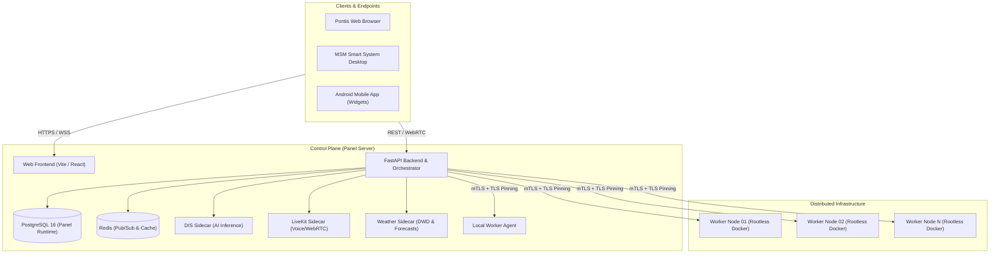

# Self-Hosting & Deployment Guide

> [!NOTE]
> Die deutschsprachige Fassung dieser Dokumentation befindet sich unter [docs/de-docs/self-hosting.md](de-docs/self-hosting.md) (im Panel unter `/docs/self-hosting`).
> PostgreSQL ist die einzige unterstützte Panel-Runtime-Datenbank.

This guide is the canonical operational documentation for deploying, configuring, and maintaining the Maunting Service Manager (MSM) ecosystem. While the repository is structured as a monorepo, its architectural components are built and packaged as decoupled, modular deployment artifacts.

---

## Architecture Overview

A production MSM deployment consists of a centralized **Control Plane** (the Web Panel) and one or more **Worker Nodes**:



### Component Roles

| Component | Responsibility | Repository Requirement |
| :--- | :--- | :--- |
| **Panel / Control Plane** | Backend orchestrator, DIS sidecar, LiveKit sidecar, Weather sidecar, Panel PostgreSQL, Vite frontend, and local worker agent. | No. The production release archive `msm-panel-<VERSION>.tar.gz` contains only the required services. |
| **Separate Frontend** | Pre-built static Vite bundle served via Caddy, Nginx, or CDN. | No. `msm-frontend-<VERSION>.tar.gz` is sufficient. |
| **Remote Worker Nodes** | Worker agent, rootless Docker engine, TLS termination, and node-local game server data. | No. Nodes fetch their self-contained agent archive directly from the control plane during enrollment (weder einen Repository-Clone noch manuelles Kopieren). |

---

## System Requirements

- **Operating System:** Ubuntu 22.04 LTS / 24.04 LTS or Debian 12 (Bookworm) recommended.
- **CPU & RAM:**
  - *Minimal (Control Plane only):* 2 vCPUs, 4 GB RAM, 20 GB SSD storage.
  - *Recommended (Control Plane + Local Instances):* 4+ vCPUs, 8–16 GB RAM, NVMe storage.
  - *Remote Nodes:* Dependent on hosted game workloads (e.g., Ark, Minecraft, Palworld).
- **Network & DNS:** A fully qualified domain name (FQDN, e.g. `panel.example.com`) with DNS A/AAAA records resolving to the server. Ports `80/tcp` and `443/tcp` must be open for automatic Let's Encrypt TLS issuance via Caddy.

---

## Recommended Quickstart Installation

Run the unified bootstrap script on your fresh server with root privileges:

```bash
curl -fsSL https://raw.githubusercontent.com/mauntingstudios/maunting-service-manager/main/scripts/bootstrap.sh \
  | sudo bash -s -- --domain panel.example.com
```

### What the Bootstrap Does Automatically

1. **Package Verification:** Downloads `msm-panel-<VERSION>.tar.gz` from the latest GitHub release and verifies its cryptographic hash against `SHA256SUMS`.
2. **System Dependencies:** Installs required runtime dependencies (`curl`, `tar`, `python3`, `git`, `caddy`, `postgresql`, `redis`, `docker.io`).
3. **Database Configuration:** Configures a dedicated, unprivileged PostgreSQL database and role (`msm`), enforcing secure authentication.
4. **Rootless Docker:** Configures user namespaces and rootless Docker to ensure hosted containers execute without host root privileges.
5. **Systemd Services:** Registers and enables systemd service units for the FastAPI backend, sidecars, and local agent.
6. **TLS Reverse Proxy:** Configures Caddy to reverse-proxy traffic to the internal backend and frontend while provisioning automatic SSL certificates.

### Resuming a Partial Installation

If an installation attempt is interrupted after creating the database role but before completing the environment configuration, resume safely without wiping existing data:

```bash
sudo bash install.sh --simple --domain panel.example.com --resume-partial
```

> [!NOTE]
> PostgreSQL 16 is the sole supported runtime database for the MSM panel. Legacy SQLite deployments are not supported and must be migrated prior to upgrading.

---

## Release Artifacts

The automated GitHub release pipeline publishes modular release archives for every tagged version (`v*`):

- `msm-panel-<VERSION>.tar.gz`: Complete Control Plane bundle (backend, sidecars, frontend, agent bootstrap, installation scripts).
- `msm-frontend-<VERSION>.tar.gz`: Pre-built static UI assets (`frontend/dist`) and configuration templates.
- `msm-agent-<VERSION>.tar.gz`: Standalone worker agent package for air-gapped or automated node enrollment.
- `SHA256SUMS`: Cryptographic checksums of all release archives.

---

## Connecting Remote Worker Nodes

Remote nodes allow you to scale server hosting across multiple physical or virtual hosts from a single panel.

1. Navigate to **Infrastructure → Nodes → Add Node** inside the MSM web panel.
2. Enter the node's hostname, public IP, and allocated port range.
3. The panel generates a one-line enrollment token:

```bash
curl -fsSL https://panel.example.com/api/agent/bootstrap.sh \
  | sudo bash -s -- --token <ENROLLMENT_TOKEN> --fingerprint <PANEL_TLS_FINGERPRINT>
```

### Security & Isolation Model

- **Mutual TLS with Fingerprint Pinning:** Remote nodes communicate exclusively over encrypted TLS. During enrollment, the worker permanently pins the Control Plane's TLS certificate fingerprint, preventing Man-in-the-Middle (MitM) attacks.
- **Zero Inbound Node Ports Required:** The agent exposes its control port only to the panel. Remote nodes do not require open management ports to the public internet.
- **Rootless Container Execution:** All game instances, bots, and voice apps run in rootless user namespaces (`cap-drop=ALL`, `no-new-privileges`). Even in the event of an application exploit, the container cannot break out to host root.

---

## Storage & Vault Architecture

<a id="tresor-cloud-dateien-im-tresor"></a>

### Encrypted Vault Storage

MSM includes an integrated Zero-Knowledge Vault for managing configuration files, credentials, secrets, and private game data.

- Encrypted vault binary blobs are stored on disk as `vault-blobs` under `/opt/msm/vault-blobs`.
- File content is encrypted client-side or at the API boundary using AES-256-GCM before reaching the database.
- **Backup Policy:** The PostgreSQL snapshot contains vault metadata and key derivations, but file blobs reside on the filesystem. Always include `/opt/msm/vault-blobs` in your daily host backup schedules.

---

## Splitting an All-in-One Deployment

To split an existing single-host deployment across multiple nodes, execute the migration helper:

```bash
sudo /opt/msm/helper-scripts/migrate-panel-components.sh
```

---

## Database Management & Studio

<a id="postgresql-datenbanken-und-das-studio"></a>

MSM features an integrated, browser-based Database Studio for managing application databases without external tools like phpPgAdmin or pgAdmin:

- **Isolated Server Databases:** Servers can be provisioned with dedicated PostgreSQL databases. Each database operates with separate credentials and strict schema isolation.
- **Direct Web Studio:** Inspect tables, view records, run diagnostic SQL queries, and import/export database dumps directly from the server dashboard.
- **Privilege Separation:** Diagnostic queries run strictly under the unprivileged database user assigned to the server, never with PostgreSQL superuser permissions.

---

## Hoster & Store Integration

<a id="hoster-and-shop-integration"></a>
<a id="hoster--und-shop-anbindung-optional-phase-6"></a>

MSM provides a dedicated API contract for external billing platforms (WHMCS, Blesta, custom e-commerce stores) to automate server lifecycles:

- **Desired State Model:** Billing platforms declare target states (provision, suspend, resume, terminate) rather than low-level operational commands, guaranteeing idempotency.
- **Granular RBAC:** Integration API keys inherit the exact access profile of their assigned service user.
- **Single Sign-On (SSO):** Customers can access their provisioned servers via cryptographically signed one-click handoff tokens without secondary passwords.
- **Detailed Reference:** See [Hoster API Reference](hoster-api.md) for full endpoint specifications, webhook signatures, and implementation examples.

---

## Credentials & Multi-Tenancy

<a id="zugangsdaten-panelweit-pro-benutzer-pro-server-phase-7"></a>

MSM structures credentials across three strict isolation layers:

1. **Panel-Wide Credentials:** System-level API keys (e.g. OpenAI, ElevenLabs, DWD, weather providers) managed exclusively by Root administrators.
2. **User Credentials:** Personal API tokens, SSH keys, and encrypted vault secrets owned by individual accounts.
3. **Server Credentials:** Instance-specific environment variables, database passwords, and webhook secrets bound to a single container instance.

---

## AI Engine & Low-Latency Voice Mode

<a id="sprachmodus-mit-der-ki-reden"></a>

MSM integrates a native AI orchestration layer designed for server operations, automated troubleshooting, and interactive voice control:

- **Dual Voice Pipeline:** Supports traditional chained pipelines (Speech-to-Text → LLM → Text-to-Speech) as well as bidirectional, low-latency OpenAI Realtime over WebRTC.
- **Guardian Security Boundary:** All autonomous tool execution (restarting containers, editing configuration files, inspecting log streams) requires evaluated permissions. High-risk operations require explicit administrative approval.
- **Safe Key Isolation:** LLM and speech provider API keys reside strictly on the backend and are never transmitted to client browsers or mobile devices.

---

## Weather Sidecar & Mobile Widgets

The self-hosted Weather Sidecar provides hyper-local weather data and official severe weather warnings:

- **Forecast Pipeline:** Retrieves forecast data via NOAA GFS and worldwide open weather APIs.
- **Official Severe Weather Warnings:** Directly integrates with official meteorological alerts (Deutscher Wetterdienst / DWD for Germany).
- **Mobile Home Screen Widget:** Powers the Android Home Screen Widget in 2×2 compact format, displaying live temperature, weather icons, hourly forecast pills, and severe warning banners with scoped authentication tokens.

---

## Maintenance & Updates

### Upgrading the Control Plane

Updates can be performed automatically via the panel interface (**System Settings → Updates**) or from the command line:

```bash
cd /opt/msm
sudo ./scripts/update.sh
```

The updater pulls the latest tested release archive, verifies checksums, runs database migrations idempotently, restarts systemd service units, and performs health-check verifications.

### Desktop & Mobile Client Updates

- **Windows Desktop App:** Automatically updates silently in the background via Velopack using signed release feeds (`releases.pontis.json` and `releases.mss.json`).
- **Android App:** Delivers APK updates verified against the SHA-256 manifest.

---

## Diagnostics & Troubleshooting

| Issue | Diagnostic Command | Resolution |
| :--- | :--- | :--- |
| **Backend API Inactive** | `sudo systemctl status msm-backend` | Check logs with `sudo journalctl -u msm-backend -n 50 -e`. Verify database connection parameters in `/opt/msm/backend/.env`. |
| **Agent Disconnected** | `sudo systemctl status msm-agent` | Ensure rootless Docker daemon is running: `systemctl --user status docker`. Verify panel TLS fingerprint matches. |
| **TLS Certificate Failure** | `sudo systemctl status caddy` | Ensure ports 80 and 443 are not blocked by firewall rules (`ufw status`) and DNS A record correctly resolves to server IP. |
| **Database Connection Refused** | `sudo -u postgres psql -c '\l'` | Verify PostgreSQL service is active: `sudo systemctl status postgresql`. Ensure `msm` database user exists. |
