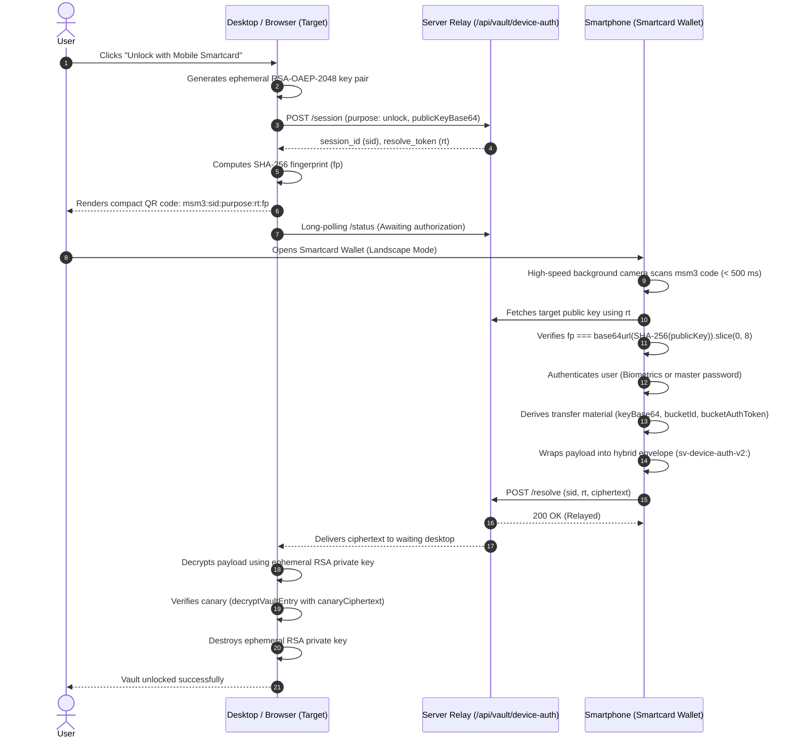

# Maunting Smartcard Architecture & Wallet Protocol

## 1. Concept & Origin

The Smartcard in Maunting Service Manager (MSM) originated from an intuitive UX observation: A cryptographic master password is an invisible, abstract concept to end users.

Under the hood, the user types a passphrase that is processed locally by a memory-hard key derivation function (Argon2id with 64 MiB RAM requirement) to produce symmetric encryption keys (`userKey`) and blind identifier seeds (`bucketSeed`). For the user, however, this process is an opaque black box.

The Smartcard (implemented internally as the *Maunting Card*) transforms this abstract cryptographic secret into an intuitive physical metaphor:
* **Visual Identity:** Modeled like a high-security payment card or cryptographic hardware token, the card features a 3D dual-sided presentation, an integrated chip graphic, user avatar, account name, validity period (*Valid Thru*), and an embossed identifier (`MSM-XXXX-XXXX-XXXX`).
* **Tactile Engagement & Aesthetics:** The interface blends clean visual design with subtle haptic vibration cues on mobile devices during unlock and authorization actions.
* **Direct Security State Visibility:** Users immediately see whether their vault is initialized, locked, unauthorized on the current workstation, or due for a cryptographic key rotation.

---

## 2. Why the Smartcard Exists: Threat Model & Practical Value

### A. Grounding the Zero-Knowledge Mental Model
In a strict zero-knowledge architecture, the server never stores or learns encryption keys or plaintext data. If a user loses their master password, their vault data cannot be recovered. Traditional password prompts often fail to convey the weight of this responsibility.

The Smartcard provides an unambiguous mental model: *You hold your personal cryptographic card, and you control which client devices are authorized to access it.*

### B. Mitigating Shoulder-Surfing and Keyloggers
To withstand offline dictionary attacks on server-stored ciphertexts, master passwords must be at least 12 characters long (`MASTER_PASSWORT_MINDESTLAENGE`). Manually typing a long, high-entropy password on external desktop computers, conference-room workstations, or shared browser sessions poses substantial risks:
1. Physical observation (shoulder-surfing) in open office or public spaces.
2. Hardware or software keyloggers on untrusted host machines.
3. Password fatigue leading users to pick predictable or reused passphrases.

### C. The Smartphone as a Smartcard Wallet
Rather than typing the master password directly on an untrusted desktop machine, the user's mobile device acts as a hardware authenticator (Smartcard Wallet):
1. The desktop displays an ephemeral, short-lived QR code.
2. The smartphone opens the Smartcard in full-screen landscape mode and scans the code via its background camera in under 500 ms.
3. The user confirms access on their phone using local biometric authentication (fingerprint or facial recognition) or a single password confirmation.
4. The derived vault key is transferred end-to-end encrypted directly to the target device via an ephemeral blind server relay. The server never observes keys, tokens, or plaintext data.

---

## 3. Master Password vs. Smartcard

| Attribute | Master Password | Smartcard (Maunting Card) |
| :--- | :--- | :--- |
| **Nature** | Raw secret passphrase (≥ 12 characters, retained only in the user's memory). | Complete protocol and interaction model (visual identity and cryptographic state machine). |
| **Storage** | Never persisted in storage. Wiped from volatile memory immediately after KDF execution. | Public and client-side metadata (status, validity, deterministic ID); no plaintext secrets stored. |
| **Cryptographic Role** | Primary entropy input for Argon2id key derivation. | Represents vault state (`uninitialized`, `unauthorized`, `locked`, `active`, `rotation_due`) and coordinates device authorization. |
| **Identifier** | None. | `MSM-XXXX-XXXX-XXXX`, deterministically derived from `bucketSeed` (no mathematical leak of password material). |
| **Cross-Device Use** | Requires manual keyboard entry on every individual machine. | Acts as a mobile hardware token for camera-based E2EE session authorization. |
| **Lifecycle** | Static until the user explicitly changes it. | Time-bound (`validThru`, 24-month default cycle) to enforce healthy key rotation. |

---

## 4. Cryptographic Derivation Logic

The Smartcard relies on DIS cryptographic primitives (`@msdis/shield`) to derive all operational artifacts deterministically and securely in memory.

```
                  ┌──────────────────────────────┐
                  │ Master Password (≥ 12 chars) │
                  └──────────────┬───────────────┘
                                 │
                                 ▼
                     Argon2id (64 MiB, t=3, p=4)
                        Salt: 16+ Bytes (Random)
                                 │
                                 ▼
                        64 Bytes Raw Output
                        in SecureBuffer
                        ┌────────┴────────┐
                        │                 │
                Bytes 0..31      Bytes 32..63
                        │                 │
                        ▼                 ▼
                    userKey          bucketSeed
                 (AES-256-GCM)            │
                                  ┌───────┴───────────────┐
                                  │                       │
                                  ▼                       ▼
                             SHA-256(seed)     SHA-256(seed || ':msm-vault-auth-v1')
                                  │                       │
                                  ▼                       ▼
                               bucketId             bucketAuthToken
                              (64 chars)           (Ownership Proof)
                                  │
                                  ▼
                           formatCardNumber
                                  │
                                  ▼
                          MSM-XXXX-XXXX-XXXX
```

### Step 1: Memory-Hard KDF (`deriveVaultTransferMaterial`)
```ts
import { argon2idRaw } from '@msdis/shield/kdf';

const rawBytes = await argon2idRaw({
  password: masterPassword,
  salt: saltBytes,
  memorySize: 65536, // 64 MiB RAM
  iterations: 3,
  parallelism: 4,
  hashLength: 64,
});
```

### Step 2: Key Separation in `SecureBuffer`
The 64-byte result is wrapped in a `SecureBuffer` immediately, while the temporary `rawBytes` array is wiped with zeroes:
* **Bytes 0..31 (`userKey`):** Symmetric AES-256-GCM content encryption key.
* **Bytes 32..63 (`bucketSeed`):** High-entropy seed used to derive blind identifiers.

### Step 3: Deterministic Blind Identifiers & Card ID
From `bucketSeed`, two values are calculated:
1. `bucketId = SHA-256(bucketSeed)`: A 64-character hex string serving as the blind bucket address on the server.
2. `bucketAuthToken = SHA-256(bucketSeed || ':msm-vault-auth-v1')`: Cryptographic proof to the server that the client is authorized to read or write the bucket container.
3. **Card ID Formatting:** The first 12 hex characters of `bucketId` form the embossed card number:
   ```ts
   // bucketId: "4a8f9c1b2e3d7788..."
   // -> MSM-4A8F-9C1B-2E3D
   formatCardNumber(bucketId);
   ```
   The card number is identical for the same master password and salt, but cannot be reversed to reveal the password or encryption key.

### Step 4: Memory Hygiene
After importing `userKey` into WebCrypto as a non-extractable `CryptoKey` and base64-encoding the transfer key, all intermediate byte buffers are zeroed (`.fill(0)`) and the `SecureBuffer` is destroyed (`.destroy()`).

---

## 5. Smartcard Wallet & E2EE Relay Protocol

The core interaction of the Smartcard system is the authorization handshake between the target desktop machine and the mobile wallet.



### 1. Compact QR Code V3 (`msm3:`)
Legacy implementations embedded the full RSA-2048 public key into the QR code (503 characters), producing dense 101x101 module matrices that took several seconds to focus in low-light conditions.

Version 3 uses a concise format:
```text
msm3:<sid>:<purpose>:<rt>:<fp>
```
* `sid`: Session ID (8 to 64 alphanumeric characters).
* `purpose`: `'authorize'` (permanent workstation authorization) or `'unlock'` (ephemeral session unlock).
* `rt`: Single-use resolve token proving physical presence and camera acquisition.
* `fp`: First 8 characters of unpadded base64url(SHA-256(publicKeyBase64)).

This code requires only around 60 characters (a coarse 45x45 matrix), which mobile phone cameras scan in under 500 ms. The fingerprint `fp` binds the key to the optical code: if a malicious relay server substitutes a rogue public key during retrieval, the phone detects the mismatch and aborts immediately.

### 2. Hybrid Envelope `sv-device-auth-v2:`
RSA-OAEP-2048 with SHA-256 can directly encrypt payloads of up to 190 bytes. Because a full authorization payload (`keyBase64`, `bucketId`, `bucketAuthToken`, metadata) exceeds this limit, the system uses a hybrid encryption envelope:
1. An ephemeral 256-bit AES-GCM key and a 12-byte IV are generated with cryptographically secure random bytes.
2. The payload is encrypted with AES-256-GCM.
3. The 32-byte AES key is encrypted using the desktop's ephemeral RSA-OAEP public key.
4. The final payload is formatted as:
   ```text
   sv-device-auth-v2:<wrappedKeyB64>.<ivAndCipherB64>
   ```
   * Delimited by a period (`.`).
   * Part 1: Base64-encoded RSA-wrapped AES key.
   * Part 2: Base64-encoded concatenation of the 12-byte IV and the AES-GCM ciphertext with authentication tag.

---

## 6. Security Guarantees & Fail-Closed Behavior

1. **Zero-Knowledge on Relay:** The relay server stores sessions strictly in volatile memory with a time-to-live of 180 seconds. Because payloads are encrypted with the target client's public key, the relay cannot inspect or manipulate keys or plaintext data.
2. **Replay Defense:** Every session ID (`sid`) and resolve token (`rt`) can only be consumed once. Sessions are destroyed immediately upon resolution or expiration.
3. **Canary Verification:** The destination client accepts a transferred key only if it successfully decrypts the vault canary item (`vault-canary`). If decryption fails, the key is wiped immediately without unlocking the interface.
4. **Ephemeral Key Lifecycles:** The RSA keypair generated on the destination desktop exists only for the duration of the handshake and is purged from memory immediately after decryption.
5. **Rate Limiting & Backoff:** Repeated failed unlock attempts on any device trigger exponential lockouts (`lockedUntilMs`) to prevent local brute-force attempts.

---

## 7. Smartcard State Model

The client-side state machine in `mauntingCard.ts` defines five distinct operational states:

| Status | Meaning | UI Badge | Allowed Actions |
| :--- | :--- | :--- | :--- |
| `uninitialized` | The user account has no cryptographic vault configured. | Gray badge: *NOT CONFIGURED* | Initialize vault |
| `unauthorized` | The current workstation is not authorized for this Smartcard. | Amber badge: *DEVICE UNAUTHORIZED* | Authorize device (via QR scan or master password) |
| `locked` | Vault is initialized and authorized, but sealed. | Blue badge: *LOCKED* | Unlock card (camera scan or master password) |
| `active` | Vault is decrypted; keys reside in volatile memory. | Green pulsing badge: *ACTIVE* | Lock vault, manage entries |
| `rotation_due` | 24-month validity period has elapsed or key rotation is scheduled. | Warning badge: *ROTATION DUE* | Execute key rotation |

---

## 8. Implementation References

* Card data model & status logic: `frontend/src/desktop/vault/mauntingCard.ts`
* Interactive 3D card UI: `frontend/src/desktop/vault/MauntingCardView.tsx`
* Mobile wallet landscape modal: `frontend/src/desktop/vault/SmartcardWalletModal.tsx`
* Ephemeral E2EE device authentication: `frontend/src/desktop/vault/deviceAuthCrypto.ts`
* Vault KDF & key derivation: `frontend/src/desktop/vault/vaultCrypto.ts`
* DIS KDF primitives: `@msdis/shield/kdf`
* DIS Secure Memory: `@msdis/shield/secure-memory`
* DIS Vault Encryption: `@msdis/shield/vault-encryption`
* DIS Core Encoding: `@msdis/shield/core`
